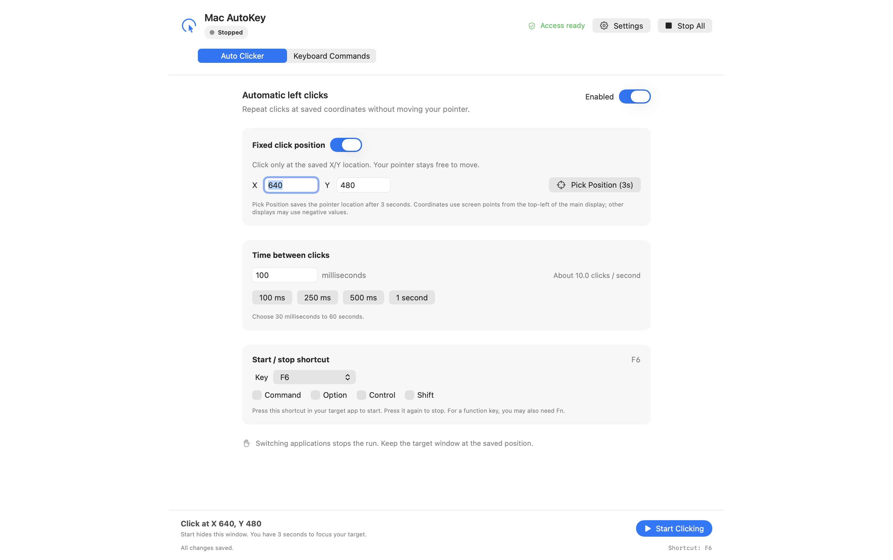

# Mac AutoKey

A native macOS 14+ menu bar utility for repeated left clicks and editable keyboard sequences. Built with Swift 6, SwiftUI, AppKit, Carbon and CoreGraphics. No external packages, clipboard paste, analytics, or network access.

## Download

Download **[Mac AutoKey v1.5.0 for Apple Silicon and Intel](https://github.com/sepulturero0/Mac-AutoKey/releases/download/v1.5.0/Mac-AutoKey-universal.zip)**, extract the ZIP, and move **Mac AutoKey.app** to Applications. See the [release notes](https://github.com/sepulturero0/Mac-AutoKey/releases/tag/v1.5.0) for installation, checksums, and compatibility details.

The app is locally ad hoc signed and is not Developer ID signed or notarized. macOS may require approval in **System Settings → Privacy & Security → Open Anyway** after the first launch attempt. Enable Mac AutoKey under **Privacy & Security → Accessibility** to allow input automation. Never disable Gatekeeper globally.



## Open and run

The built application is **`dist/Mac AutoKey.app`**. Copy it to a stable location such as `/Applications`, then open it. The configuration window opens on launch; closing it leaves the menu bar icon running. The app never starts automation on launch. Quit from its menu to stop and exit.

To build in Xcode 16 or newer:

1. Open `MacAutoKey.xcodeproj`.
2. Select the **MacAutoKey** scheme and **My Mac** destination.
3. Build and run with **⌘R**. No paid developer account is required: the project uses local ad hoc signing with no team.
4. Run unit tests with **⌘U**. Stop a separately running release app first so the test host can register its hotkeys.

The checked-in Xcode project is complete; XcodeGen is not needed. `Scripts/generate-xcode-project.py` can regenerate it using Python's standard library if source files are added. Python is a development helper only; the app does not use it.

With Apple Command Line Tools (or Xcode):

```sh
Scripts/build-app.sh             # current architecture
Scripts/build-app.sh --universal # Apple Silicon + Intel
Scripts/test.sh                  # Swift Testing, including CLT framework discovery
open 'dist/Mac AutoKey.app'
```

`swift build` also compiles the executable. Launch the bundled `.app` for stable application identity and permission handling. The build script signs locally and verifies the signature. The universal binary has been cross-compiled for Intel; testing on actual Intel hardware is still required.

## Accessibility permission

Open **Settings** in Mac AutoKey. Click **Request Access**, then **Open System Settings**. Under **Privacy & Security → Accessibility**, enable Mac AutoKey. If absent, add the built `.app` with the `+` button. Return and click **Check Again**. Quit and reopen the app if macOS has not refreshed the grant.

Permission allows the app to send native keyboard and mouse events. The app checks both Accessibility trust and event-posting access before every generated action. A denied or revoked grant stops input with an actionable message. It does not edit TCC databases or change security settings. Carbon global hotkeys do **not** require an Input Monitoring event tap; this version does not request Input Monitoring.

Keep the app in one location. Ad hoc signatures change when code changes, and macOS may require removal and re-addition of the Accessibility entry after a rebuild. For consistent local signing, set `MACAUTOKEY_SIGN_IDENTITY` to an existing suitable code-signing identity when running the build script. Developer ID signing and notarization are not included; distribution to other Macs may require a deliberate Gatekeeper approval or a separately signed/notarized build. Never disable Gatekeeper globally.

## Auto Clicker

1. Enable Auto Clicker.
2. Choose an activation key and Command/Option/Control/Shift modifiers. Default: **F6**. Some keyboards need **Fn+F6** or “Use F1, F2, etc. as standard function keys.”
3. Set the interval to **30–60,000 ms**; default **100 ms**.
4. Focus your target application and position the pointer. Press the shortcut to toggle clicking.
5. Press the same shortcut again, **⌘⇧Escape**, or **Stop All** in the menu to stop.

The **Start in 3 Seconds** button hides Mac AutoKey, restores the application underneath it, and gives you time to focus the target and position the pointer. Each click is a real left mouse-down/up pair at the current pointer position. No coordinates are stored and the pointer is not moved. There is one cancellable click task, with no catch-up bursts after a delay.

## Keyboard Automation

Use **Add Command** to create up to 50 independent named commands. Each has its own hotkey, enabled switch, text mode, per-key delay, and ordered actions. Select one in the command sidebar to edit it; **Duplicate** copies its actions with a new unused shortcut. Delete removes only the selected command; **Undo Delete** restores the last removed command. Existing single-sequence settings migrate automatically without changing their shortcut, text, or delays.

The initial command is **15 then 10**, with shortcut **Command + Up Arrow**. Its editable example is:

| Step | Action | Value |
|---|---|---|
| 1 | Type Text | `15` |
| 2 | Wait / Delay | 500 ms |
| 3 | Press Key | Enter |
| 4 | Wait / Delay | 500 ms |
| 5 | Type Text | `10` |
| 6 | Press Key | Enter |

In a compatible plain text document this produces `15`, a newline, `10`, and a final newline. Each key has a down/up pair. The default **60 ms per key** delay is added after each typed character or Press Key action, in addition to explicit waits. Open **Typing options** to adjust it from **20–2,000 ms** or change text input mode. Wait actions support **0–600,000 ms**.

Use **Add Step** to choose text, a key, or a wait directly. Change the action type in its row if needed. Keys include letters, digits, punctuation, Enter, Tab, Space, Backspace, Escape, arrows, navigation keys, and F1–F20. Open a step’s **…** menu to move it up/down or delete it. All valid changes save automatically; **Settings → Troubleshooting → Save and Retry Shortcuts** also validates and retries registration. Invalid settings remain visible for correction while the last valid stored configuration is preserved, and automation hotkeys are disabled until corrected. Maximum: 500 steps per command, 10,000 characters per text action. Shortcut assignments must be unique across commands, the clicker, and Stop All, including disabled commands.

The fixed bottom **Run Command** button hides Mac AutoKey and restores the app beneath it for a manual run. Focus the intended text field during the countdown. Background hotkey runs wait briefly for physical shortcut modifiers to be released, then start. Repeated activation while already running is ignored. Clicking and keyboard sequences are mutually exclusive. Editing settings stops an active run.

Text modes:

- **Physical keys (US layout)** sends actual virtual key events for common US ANSI characters. It works best with a matching local and remote US layout. Unsupported characters produce validation errors.
- **Unicode characters** sends one character at a time using Unicode-bearing CGEvents; Enter and Tab remain physical keys. Some remote sessions ignore this mode. It never pastes through the clipboard.

A sequence that could generate one of its own activation shortcuts is rejected. Add Command, Control, or Option to that shortcut. This avoids feedback through Carbon, which does not expose CGEvent source tags. Shift is released in the same synchronous event group as its key, so cancellation cannot strand it.

## Stop and focus protection

**Command + Shift + Escape** is the fixed emergency Stop All shortcut. A registration warning means it is unavailable: use the menu bar's **Stop All** or the window button, then resolve the conflict. Quit also cancels all work. Every delay is cancellation-aware; an in-flight down/up pair finishes together. macOS may already have queued an event, which the app cannot retract.

All runs bind to the foreground application PID at the start. Switching applications, locking the user session, or sleeping the display stops the run. A new focused app never inherits an existing run, even if both are allowed. Pressing a physical modifier during a run also stops it to avoid modified clicks/keystrokes. Protection works at the **application** level: switching windows within one process does not stop a run. Focus checks cannot eliminate the tiny system-level race between checking focus and event dispatch.

**Citrix Only** additionally requires the target to match an explicit allowed bundle identifier **and** canonical application-bundle path. To set it up:

1. Focus the actual remote-session viewer, then return to Mac AutoKey.
2. Open **Settings**, enable **Citrix Only**, and use **Allow Recent: …**, verifying the named app is the intended viewer. Alternatively, click **Capture Target in 3 Seconds** and switch to its window.
3. Review the saved name, bundle ID, and path (shown on hover). Remove obsolete targets using the minus button.
4. Refocus the remote session and use the hotkey.

No Citrix process name is assumed. You can explicitly allow any app, so review your choices. This is a focus guard, not an application-authentication or enterprise security boundary.

For regular local testing, turn Citrix Only **off** and use a new TextEdit plain text document. Never test clicking on a destructive control or a live transaction.

## Shortcut conflicts

The key picker and modifier checkboxes update registration immediately without restarting. Duplicates and several known system shortcuts are rejected. Other conflicts return a visible macOS registration error; the app does not override an existing owner. Registration success cannot prove that a remote client will deliver a shortcut. Command + Up is also a normal application navigation command; choosing it assigns that combination to this utility while it is enabled. Disable the feature or choose another shortcut to restore its usual target-app behavior.

If Command + Up is intercepted or unavailable, try **Control + Option + F9** for the sequence and **Control + Option + F8** for clicking. System shortcuts, Secure Input, keyboard hardware mappings, remote client capture, and administrator restrictions may affect delivery.

## Citrix validation

**Citrix delivery is not verified by unit tests or installation of Citrix Workspace.** A real remote session must be tested. See [docs/CITRIX_TEST_CHECKLIST.md](docs/CITRIX_TEST_CHECKLIST.md) and [docs/TEST_RESULTS.md](docs/TEST_RESULTS.md) for the current evidence and remaining checks. The app uses normal Quartz events posted to the HID event stream. It never injects code, modifies Citrix, or bypasses session security.

## Troubleshooting

- **No input:** Read the red error message and open **Settings → Troubleshooting** for the actual permission checks, app path, saved clicker shortcut, and last start. Click Check Again, refocus the target, and release modifier keys. If rebuilt or moved, remove and re-add the correct app in Accessibility and relaunch it.
- **Starts then stops:** Inspect the status and notice. Focus change, modifiers, invalid settings, disabled features, and revoked permissions stop input. Manual runs restore the previous application; focus the intended field during the 3-second countdown. Duplicate activation notifications for the same target do not cancel a run.
- **Wrong letters:** Physical mode uses US key positions. Align local/remote layouts or test Unicode mode.
- **Missing/merged remote keys:** Increase the per-key delay and test both text modes. Citrix may reject Unicode or synthetic input entirely. Ask the administrator for supported configuration; do not bypass policy.
- **Shortcut does nothing:** Read registration warnings, try the alternatives above, check Fn behavior and other utilities, and test locally with Citrix closed. Stop and start the app to retry registration.
- **Settings:** Stored locally under `com.macautokey.app`, key `MacAutoKey.Configuration.v1` (schema version 2; the storage key remains unchanged for migration). No running state is persisted. A malformed or future-version configuration shows a warning and defaults; it is replaced only after an explicit save/edit.

See [docs/ARCHITECTURE.md](docs/ARCHITECTURE.md) for component responsibilities and test boundaries.

For a safe live acceptance procedure and the optional disposable input receiver, see [docs/LOCAL_TEST_CHECKLIST.md](docs/LOCAL_TEST_CHECKLIST.md). Debug-only own-window captures can be requested with `--diagnostics /absolute/output/base --exit-after-diagnostics` (and `--keyboard-tab` / `--dark`); they disable hotkey registration for preview, require macOS 14.4+, capture only the app's own window, and are omitted from release builds.

After granting Accessibility, quit any running Mac AutoKey instance and run `Scripts/verify-local-input.sh` for an opt-in live integration check against the disposable Cocoa editor/counter. This command uses isolated test settings, invokes real Quartz keyboard and mouse events and the registered Carbon shortcuts, and writes `docs/evidence/local-input.json`. For click-test setup only, the receiver places the pointer over its harmless counter; the harness restores its original position afterward and stops if the pointer leaves that rectangle. The normal Auto Clicker never moves the pointer. The harness closes its configuration window to exercise background operation, checks focus-loss/cancellation, then quits. Synthetic shortcut activation is reported separately from physical hardware testing. This local-only command never targets Citrix or an existing document.

To check actual hardware hotkeys, run `Scripts/verify-local-input.sh --physical-hotkeys`. Click inside the receiver's editor, press **Command + Up** once and release. When the click counter appears, press **F6**, wait one second, and press **F6** again; then press **F6**, wait one second, and press **Command + Shift + Escape**. Use Fn+F6 if your keyboard maps the key to a media function. The test waits at most ten minutes per stage, stops safely on timeout, and writes `docs/evidence/physical-hotkeys.json`. Its configuration window is closed throughout this check, so successful events also demonstrate background operation.

For a read-only permission diagnostic from the actual bundled app, quit the app and run `open -W -n "dist/Mac AutoKey.app" --args --permission-report /tmp/macautokey-permissions.json`. This writes only app identity, permission flags, clicker shortcut, command count, and target restriction state; it sends no input and exits. Launching through Finder/Launch Services matters because a terminal-launched process can have different permission responsibility.

## Friendlier interface in 1.2

Commands are always visible in the sidebar. Select a command, edit its name and shortcut, then use Add Step for text, keys, or delays. Typing options contains advanced input settings. The bottom Run/Stop bar stays visible even when the steps scroll. The clicker offers interval presets and an approximate click rate. Settings contains permissions and optional Citrix restrictions; Command+comma opens it. All edits autosave. Deleting a command offers one-level Undo Delete.

## Status indicator and pause / resume (1.3)

The window header, command sidebar, and menu bar show the current state with text as well as color: **green Running**, **amber Paused**, **gray Stopped**, **blue Starting**, and **red Error**. A completed keyboard command returns to Stopped; its sequence does not repeat automatically.

To pause without switching away from your target, open Mac AutoKey’s menu bar menu and choose **Pause**. Choose **Resume** there to continue. A paused run sends no new input and freezes the remaining key/click/step delay; resuming continues at the same character/step. The main window also provides Resume, with three seconds to refocus the original target. Resume is blocked in a different application. You may inspect the configuration window while paused, but editing settings ends that run; locking/sleeping the session also stops it. Stop All, quitting, and the clicker’s existing toggle shortcut still end the run and cannot be resumed. Already-posted system events cannot be retracted.

## Fullscreen layout (1.4)

Fullscreen keeps the command list, editor, header, and Run/Stop controls within a centered workspace. Keyboard editing uses a wider workspace than Auto Clicker, with a readable maximum field width. The sidebar and steps scroll independently, and the bottom controls remain visible when the window is resized.

## Fixed click position (1.5)

In Auto Clicker, turn on **Fixed click position** to click only at saved X/Y coordinates while leaving your pointer free. Enter the coordinates directly, or choose **Pick Position (3s)** and move the pointer to the desired spot before the countdown ends. Picking sends no click. Focus your target and use your clicker shortcut, or use Start Clicking and its three-second target countdown. Turn the switch off to return to clicking at the pointer.

Coordinates use screen points, starting at the top-left of the main display; other displays may have negative coordinates. Keep the target window at the saved location and focused. The app stops if another application covers that position, the position leaves the connected displays, or the target loses focus. Fixed mode uses process-directed mouse events rather than moving the hardware pointer; some applications and remote sessions may not accept them. Native local button delivery is tested; Citrix fixed-position delivery remains unverified.
